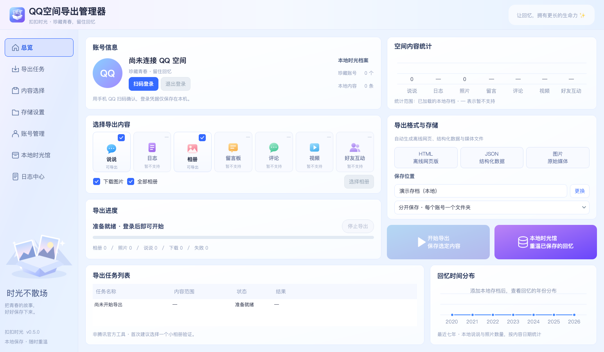

# 扣扣时光 · QZoneCapsule

**把 QQ 空间的说说与相册，装进自己的时光胶囊。**

[English](README.en.md) · [下载预览版](https://github.com/MoYu2008Fish/QZoneCapsule/releases) · [反馈问题](https://github.com/MoYu2008Fish/QZoneCapsule/issues)

一个本地运行的 QQ 空间归档桌面工具：扫码登录，选择说说与相册，导出到电脑，再离线翻看。

> 当前为 **0.4.0 桌面预览版**。已验证 macOS 应用启动、真实登录二维码获取与取消流程，并完成本地相册元数据导出验证；全量图片下载和说说完整性仍待验收。请先用一个小相册测试，不保证历史内容、原图或私有接口始终可用。



## 可以做什么

- **说说与相册一起归档**：说说正文、发布时间、位置、配图，以及相册信息和照片。
- **选择保存范围**：全部相册，或读取列表后逐个勾选；说说和相册可以单独导出。
- **图片优先尝试原图**：原图地址不可用时回退到其他候选，并记录实际采用的画质来源。
- **保留时间信息**：记录拍摄/上传时间，设置文件修改时间；安装 ExifTool 后尝试补写缺失的 EXIF 拍摄时间，已有拍摄时间不覆盖。
- **后台任务与停止**：窗口保持可操作，停止后保存已获取内容；重新导出时重新扫描，跳过已有非空文件，补下载缺失文件。
- **本地查看与结果报告**：SQLite、离线 HTML 查看器，以及区分完成、部分失败、中断和停止的 `last-run.json`。
- **应用内时光馆**：无需登录，直接浏览已有存档里的说说、相册与照片；支持搜索、时间线、相册内浏览和图片放大。
- **空间动态预览**：蓝白动态卡片、相册网格、年份筛选和「查看全部」；全部结果可连续浏览。已确认的 QQ 表情编号使用系统 Emoji 替代，未知编号保留提示。
- **多账号分开或合并**：导出时选择每个账号一个文件夹，或汇入同一存档；查看时随时切换单个账号或合并全部账号，内容保留账号来源。

## 下载与运行

### macOS Apple Silicon

从 [Releases](https://github.com/MoYu2008Fish/QZoneCapsule/releases) 下载 `QZoneCapsule-0.4.0-macos-arm64.zip`，解压后打开 `QZoneCapsule.app`。

此预览版只有本地临时签名，**未做 Apple 开发者签名与公证**。如系统拦截，请在确认来源是本仓库后，按 macOS 的正常应用授权流程打开。

Windows、Linux 和 Intel Mac 暂未提供经过验证的安装包，可从源码运行；跨平台兼容性仍待验证。

### 从源码运行

需要 Python 3.10+，具体系统版本需满足 PySide6 的运行要求。

```bash
git clone https://github.com/MoYu2008Fish/QZoneCapsule.git
cd QZoneCapsule
python3 -m venv .venv
source .venv/bin/activate
python -m pip install -e '.[desktop]'
qzonecapsule
```

Windows 将激活虚拟环境的命令改为 `.venv\Scripts\activate`。macOS 开发目录也可双击 `启动扣扣时光.command`。

## 使用

1. 点击「扫码登录」，用手机 QQ 扫码并确认。
2. 勾选说说、相册和是否下载图片。可以先读取相册列表，取消勾选不需要的相册。
3. 选择保存位置及「分开保存／合并保存」，点击「开始导出」。前者在所选目录下按 QQ 号建立文件夹；后者写入「合并存档」，随后切换登录账号可继续汇入同一存档。
4. 点击顶部「本地时光馆」或底部「打开本地存档」，直接在应用内查看。可以按账号、内容类型或文字搜索，点击相册内的「浏览此相册」进入，点击图片放大。
5. 旧存档自动从当前保存目录识别，也可「添加已有存档」选择账号文件夹或包含多个账号的根文件夹。账号选择框可分开或合并查看，退出登录仍可使用。
6. 已有分开保存的文件夹不会被移动；合并查看直接汇总它们。重复导出的同账号同条目优先使用带本地图片的副本。合并保存的图片仍按账号隔离；`last-run-<QQ号>.json` 分别保留各账号最近一轮结果。
7. 时光馆中的「归档结果」列出未完成条目；暂不支持的视频与真正下载失败分开统计。点击「查看全部」会重置账号、年份与搜索条件。

登录凭据默认保存在 `~/.config/qzone-archiver/session.json`（兼容早期原型路径，可通过 `XDG_CONFIG_HOME` 调整）。桌面二维码只在内存中显示；退出登录会删除保存的会话文件。

## 命令行

```bash
# 二维码写入当前目录 qrcode.png
qzonecapsule-cli login --qrcode

# 说说、相册和图片
qzonecapsule-cli sync --out ./backup

# 仅说说文本
qzonecapsule-cli sync --out ./backup --no-albums --no-media

# 先测试一个相册
qzonecapsule-cli sync --out ./backup --no-moods --limit 1

qzonecapsule-cli export --out ./backup
qzonecapsule-cli status --out ./backup
qzonecapsule-cli verify --out ./backup
```

请求默认间隔 0.8 秒。命令行不会自动在输出目录追加 QQ 号，命令行同步默认要求不同账号使用不同文件夹；桌面版提供合并保存选项。保留了早期 `qzone`、`qzone-desktop` 命令别名。

## 文件与时间

```text
<所选目录>/<QQ号>/
├── qzone.db          # 文本、元数据、媒体记录与原始响应
├── index.html        # 离线查看器
├── data.js           # 查看器数据
├── last-run.json     # 本轮任务结果与失败条目
└── media/<QQ号>/
    ├── photos/<相册ID的哈希>/
    └── moods/
```

拍摄时间优先于上传时间；时间来源记录在 SQLite 中。安装 [ExifTool](https://exiftool.org/) 后可补写图片时间，否则只设置文件修改时间，并记录 `mtime-only` 状态。备份报告中的下载数是本轮下载量，跳过数是复用的已有文件量。

## 当前限制

- **视频暂不解析或下载源文件**，仅保留相册接口返回的元数据，并列为未完成。
- 未实现完整评论/回复分页归档；现有点赞和评论数量不等于完整互动记录。
- 无法保证读取所有历史、不可见或已删除内容，不绕过空间访问权限。
- 不支持 HTTP Range 字节续传；补下载会重新扫描所选来源，尚无独立的失败任务重试按钮。
- EXIF 回写依赖外部 ExifTool，安装包未捆绑它；原图是否可用取决于服务端提供的资源。
- 网页私有接口、登录及媒体地址可能随时变化；已有非空文件会被复用，当前没有全量哈希校验。
- 尚未完成真实账号端到端验收，Windows/Linux 也未做设备验证。

## 开发与反馈

```bash
python -m pip install -e '.[desktop,dev]'
ruff check .
TZ=Asia/Shanghai pytest -q
```

本地自动检查通过；测试使用临时数据或模拟网络响应，不替代真实账号验证。[详细验证记录](docs/desktop-validation.md) · [调研与设计](docs/research-and-plan.md) · [贡献说明](CONTRIBUTING.md)

反馈时提供系统、应用版本、复现步骤和已脱敏的结果报告即可。**不要公开 Cookie、二维码、完整备份或含签名参数的媒体链接。**

## 隐私与开源

本项目不是腾讯官方产品，与腾讯、QQ 或 QQ 空间无隶属或授权关系。仅归档你有权访问的内容。

登录与内容请求直接访问腾讯接口，图片从接口提供的媒体地址下载；不使用中转服务器，不包含云上传或遥测。Cookie 会发送到登录和采集所需的腾讯接口，不会主动发送给本项目作者；原始响应、离线存档和媒体地址可能包含个人信息，请自行保管备份目录。

本项目原创代码采用 [MIT](LICENSE)。Qt/PySide6 及其他依赖遵循各自许可证，详见 [第三方说明](THIRD_PARTY_NOTICES.md)。

参考项目：[QZoneExport](https://github.com/ShunCai/QZoneExport)、[QzonePhoto](https://github.com/11273/QzonePhoto)、[QZAlbumTool](https://github.com/kahotv/QZAlbumTool)。本项目参考其公开功能与流程，未复制其项目代码；不表示关联或背书。
